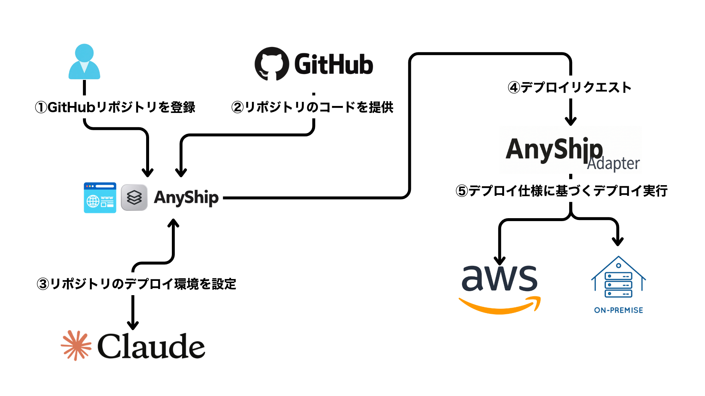

# AnyShip-wide

[한국어](README.md) | **日本語**

*AnyShip-wide* は、[anyship](https://github.com/gumtiket/anyship) をインポートして個人開発を続けているリポジトリです。


## 概要

AnyShip は、GitHub リポジトリの URL を入力すると、AI が 12-factor の原則に基づいてコードを分析し、デプロイ可能な形に修正したうえで AWS またはオンプレミスのサーバーへデプロイするサービスです。

---

### 解決したい課題

コードをサーバーに載せるには、アプリを環境に合わせて直す作業（設定の分離、ステートレス化、コンテナ化）と、環境ごとに異なるデプロイ手順を覚える作業が必要です。AnyShip はこの二つを代わりに引き受けます。


**AI は 12-factor の原則**を基準にコードを診断・修正し、Dockerfile と `/healthz` を作成して GitHub に PR として提出します。


アダプターで環境に合わせます。**アプリは環境を知らず**、環境ごとの違いはあらかじめ用意したアダプターとインフラ構成セットが吸収します。AI がインフラのコードを直接作ることはありません。

---

### アイデア

> アプリは環境を知らず、環境は外部から注入する。


アプリと環境の間に環境に依存しないデプロイ仕様を置き、すべての環境で同じコンテナイメージを使います。

これにより AWS とオンプレミスを同じ方法で扱え、GCP や Azure にはアダプターを追加するだけで対応できます。

---

### 利用の流れ (https://app.anyship.cloud/)

1. GitHub でログインし、リポジトリの URL と基準ブランチを登録します。
2. デプロイ環境（AWS またはオンプレミス）を接続します。
3. 分析をリクエストすると、違反の一覧と修正項目が作成されます。
4. 変更案（diff）を確認して選択し、GitHub の Draft PR として提出します。
5. マージしたコミットをイメージとしてビルドして環境にデプロイし、進行ログを画面で確認します。



---

## 中核となる設計

### 設計原則

> アプリは環境を知らず、環境は外部から注入する。

- アプリは `DATABASE_URL` や `PORT` などの環境変数だけを読みます。どの環境で動いているかを知る必要はありません。
- 環境ごとの違いは**アダプター**と**事前構成セット**が吸収します。
- すべての環境で**同じコンテナイメージ**を使います。
- AI が行うのはコードの修正、セットの選択、変数値の設定だけです。インフラのコードはチームが事前に用意します。

### デプロイ仕様

アプリと環境の間の契約です。環境に依存する値は含まず、AI がコードを見て作成し、スキーマで検証します。

```yaml
app: todo-app
port: 8080                       # PORT 環境変数として注入
healthcheck: /healthz
env:
  - name: SECRET_KEY
    secret: true
    generate: true               # 入力がなければアダプターが生成
  - name: LOG_LEVEL
    value: info
backing_services:
  - type: postgres
    bind_as: DATABASE_URL        # 環境に応じて RDS または Postgres コンテナを接続
release:
  migrate: alembic upgrade head  # デプロイごとに一回限りの作業として実行
workload:                        # AI がセットを選ぶ根拠
  type: request-driven
  max_request_seconds: 10
  websocket: false
```

### 事前構成セット

チームがあらかじめ用意したインフラのテンプレートです。AI は `workload` を見てその中から一つを選びます。
同じ仕様から同じ結果を再現でき、AI がセキュリティ上脆弱なインフラを作ることも防げます。

| セット           | 構成                                                        | 選択条件                                       | 状態     |
| ---------------- | ----------------------------------------------------------- | ---------------------------------------------- | -------- |
| `aws-always-on`  | 共用 EC2 ホスト + Docker Compose + Traefik、共用 RDS        | 長いリクエスト、バックグラウンド処理、安定したトラフィック | 実装済み |
| `onprem`         | ユーザーのサーバー + Docker Compose + Traefik、Postgres コンテナ | ユーザーがオンプレミスを選択                   | 実装済み |
| `aws-serverless` | Lambda + Function URL + 共用 RDS                            | 短いリクエスト、断続的なトラフィック           | 予定     |

### アダプター

すべての環境アダプターは同じインターフェース（`check`、`deploy`、`status`、`rollback`、`destroy`）を
実装します。サービス本体は環境がどう動くかを知らず、これらのメソッドを呼ぶだけです。

| 仕様の項目               | AWS (always-on)                              | オンプレミス                                   |
| ------------------------ | -------------------------------------------- | ---------------------------------------------- |
| 実行                     | EC2 + Compose                                | Compose                                        |
| イメージの受け渡し       | サービスサーバーでビルドしてホストへ転送     | サービスサーバーでビルドして SSH で転送        |
| DB (`postgres`)          | 共用 RDS（アプリ専用アカウント）             | Postgres コンテナ                              |
| ポート・HTTPS            | Traefik                                      | Traefik                                        |
| ロールバック             | 以前の SHA で再デプロイ                      | 以前の SHA で再デプロイ                        |
| スキーマのマイグレーション | ホストで一回限りのコンテナを実行           | `compose run`                                  |

オンプレミスのサーバーには SSH で接続し、デプロイ専用アカウントで Docker コマンドを実行します。
インバウンドのポートを開けられない社内ネットワーク向けのエージェント方式は、今後の対応範囲です。

---

### AI の役割と統制

| 役割         | 出力                               | 統制の仕組み                                 |
| ------------ | ---------------------------------- | -------------------------------------------- |
| 診断         | 12-factor 違反の一覧               | 結果を画面に表示                             |
| 変換         | コードの diff、Dockerfile、`/healthz` | 検証ゲート → PR、リスクのある変更は承認制 |
| 仕様の生成   | デプロイ仕様（YAML）               | スキーマ検証                                 |
| セットの選択 | セット名、変数値                   | ルール検査 + Terraform の `validation`       |
| 根拠の提示   | 選択理由、想定コスト               | ユーザーの承認                               |
| 失敗の分析   | 原因と修正案                       | 再試行の上限は 3 回                          |

AI がインフラを直接変更できないよう、`.tf` ファイルの生成・修正は行わず、許可された範囲の値だけを埋めます。

### デプロイの安全性
- **ロック**: プロジェクト単位で確保し、オンプレミスではサーバー（環境）単位でも確保して、
  同じサーバーを使う別プロジェクトの作業と重ならないようにします。
- **期限切れと復旧**: 確保は 30 分で期限切れになり、作業中はログを保存するたびに延長されます。
  ワーカーが落ちても、次のリクエストがその作業を中断扱いにして引き継ぎます。
- **重複防止**: リクエスト ID により、同じリクエストは一度だけ実行します。
- **上書き防止**: 遅れて終わった古い作業が、新しい作業の状態を書き換えることはありません。
- **ロールバック**: 以前のコミット SHA のイメージで再デプロイします。DB スキーマは元に戻しません。

---

## 既知の制限

現在の実装は、サンプルリポジトリを対象とした MVP です。以下の項目は把握済みで、今後の対応範囲です。

### セキュリティ

| 制限                                                         | 影響                                                         | 現在の対策                                                   |
| ------------------------------------------------------------ | ------------------------------------------------------------ | ------------------------------------------------------------ |
| ユーザーのリポジトリの Dockerfile を**サービスサーバー上で**ビルドします。隔離されたビルド環境はありません。 | 悪意のある `RUN` 命令がサーバー上で実行される可能性があります。サーバーの IAM ロールはユーザーアカウントへの AssumeRole 権限を持っています。 | サンプルリポジトリでのみ使用。一時コピーでビルド、`.git`・`.env*` を除外、シンボリックリンクは追跡しない、AWS の環境変数・トークンをビルドプロセスに渡さない、制限時間を設定 |
| AWS オンボーディング用ロールが `AdministratorAccess` です。   | サービスがユーザーアカウントで必要以上の権限を持ちます。     | 今後、最小権限に縮小                                         |
| オンプレミスの SSH デプロイ鍵をすべての環境で**共有**しています。 | 鍵が漏れると、登録済みのすべてのサーバーが影響を受けます。   | デプロイ専用アカウント、鍵認証のみ許可。環境ごとの鍵は今後対応 |
| アプリのシークレットをホストの `app.env` に保存します。       | ホストを入れ替えるとシークレットが引き継がれず、再デプロイのたびにユーザー入力のシークレットを渡し直す必要があります。 | ログと結果ではマスキング。Secrets Manager での保管は今後対応 |
| シークレットのマスキングは汎用のシークレット検出ツールの代わりにはなりません。 | 認識できない形式のシークレットが残る可能性があります。       | 既知のパターンをマスキング。変更案にシークレットが残っている場合は PR 用の結果を生成しない |

### デプロイ先と接続

- オンプレミスは **SSH による転送のみ**対応しています。サーバーにはパブリック IPv4 と 22/80/443 番ポートへの接続が必要で、プライベートネットワークやインバウンドを開けられない環境には対応していません（エージェント方式は今後対応）。
- 動作を確認したサーバーは Amazon Linux 2023 x86_64 のみです。Ubuntu などは検証していません。
- AWS は常時稼働コンテナ（`aws-always-on`）のセットのみ実装されています。Lambda のセットはありません。
- ファイルストレージ（`object_storage`）は警告を出したうえでスキップします。
- アプリの削除で消えるのはコンテナ、ボリューム、アプリのフォルダだけです。**アプリの DB、共用基盤（ホスト・RDS）、DNS レコードは残ります。**

### 運用

- **リモート環境がなくなると削除できません。** インフラを直接削除した場合、サーバーへの接続に失敗するとサービス側のデプロイ記録が残り、プロジェクト接続の削除もできなくなります。強制削除（サービス側の記録のみ削除）が必要です。
- サービスは**単一プロセス**でしか実行できません。複数の Uvicorn ワーカーや複数ホストに分散すると、プロセスロックとメモリ上の状態のために動作しません。
- ロールバックで戻すのはイメージだけです。**DB スキーマは元に戻さない**ため、マイグレーションが変わったバージョンへロールバックすると、アプリとスキーマが合わなくなる場合があります。
- 既存のデータを新しい環境へ移す機能はありません。
- アプリのログやメトリクスを見る画面はありません。提供しているのはデプロイの進行ログだけで、リアルタイムのプッシュではなく 1〜2 秒間隔のポーリングです。

### AI と変更の範囲

- 開発モード（`APP_AI_MODE=placeholder`）では、実際の AI の代わりに、案内コメントのファイルを追加する固定の項目を返します。
- Web ワーカーは **Docker 検証ゲートを実行しません。** 結果は `skipped`、`pr_eligible=false` となり、合格としては扱いません。Draft PR の作成は、機能全体の検証やデプロイの承認を意味しません。
- 変更案は最大 100 ファイル、2 MiB までで、ファイルの削除と名前の変更には対応していません。
- ソース分析の上限: 1 ファイルあたり 512 KiB、合計 20 MiB、tree の項目数 2,000 件。リンクとサブモジュールには対応していません。
- 項目ごとの修正の再実行と、PR コミットからの自動デプロイ連携は今後対応します。

---
